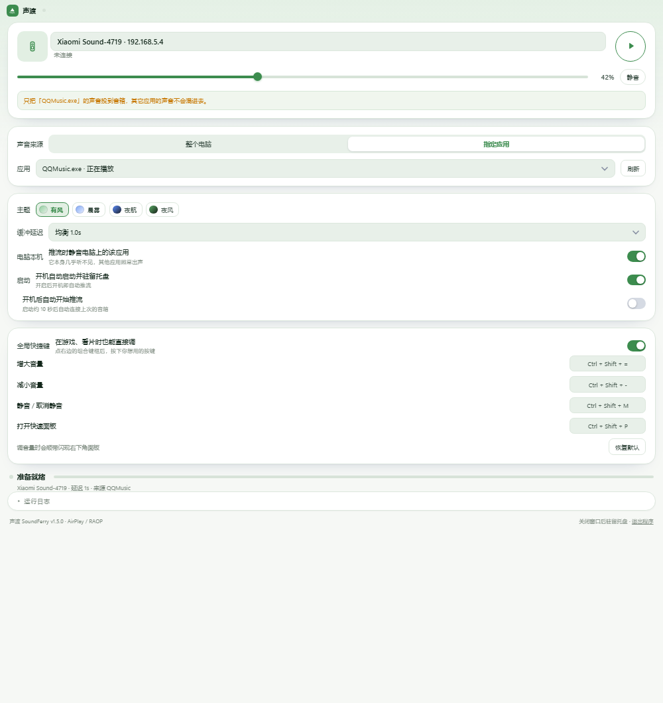
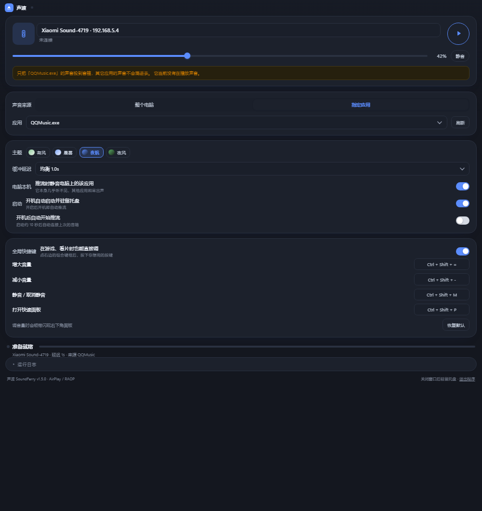
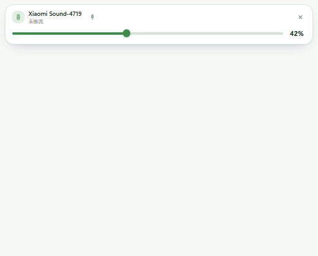

# 声渡 SoundFerry

**把 Windows 电脑的声音，通过 AirPlay（RAOP）无线投到小米 Sound 音箱。**
不装虚拟声卡、不需要 ffmpeg、不落地任何临时文件，全程在内存里实时传 PCM。

> Cast your Windows PC audio to any AirPlay speaker (tested with Xiaomi Sound) —
> no virtual sound card, no ffmpeg, no temp files. Native Windows app with tray,
> themes and global hotkeys.

[](LICENSE)


| 「有风」主题 | 「夜风」主题 | 快速音量面板 |
| --- | --- | --- |
|  |  |  |

## 下载

到 [**Releases**](../../releases) 页面下载 `SoundFerry_Setup_vX.Y.Z.exe`（用户级安装，不需要管理员权限），双击安装即可。

或者直接从源码运行（见下文「从源码运行」）。

## 功能一览

- **整机 / 指定应用推流**：把整个电脑的声音投给音箱，或只投某个应用（其他应用照常在电脑上出声）
- **原生窗口**：界面由 Windows 自带 WebView2 内核承载，无边框、Win11 原生圆角、按内容与屏幕分辨率自适应尺寸，不是浏览器窗口
- **系统托盘**：图标随连接状态变化（灰=空闲 / 黄=连接中 / 绿=推流中 / 红=出错），右键菜单可开始/停止推流、开机自启动、退出
- **快速音量面板**：托盘左键或状态变化时在桌面右下角弹出，只有「设备名 + 音量条」；
  点击面板外自动收起，点「图钉」可常驻置顶
- **四套主题**：有风 / 晨露 / 夜航 / 夜风，一键切换
- **全局快捷键**：增减音量、静音/取消静音、唤出快速面板，均可在界面里自定义绑定
- **音量直达音箱**：通过 AirPlay 音量指令控制音箱音量；每次连接自动把音箱音量设为 1%，防止突然炸响；音箱不支持远程音量时自动退回电脑侧增益
- **异常自恢复**：推流中断自动重连；程序异常退出也不会把电脑留在静音/压低音量状态（启动时自动恢复）

## 使用

1. 电脑和音箱连同一个 Wi-Fi。
2. 启动后界面里选好音箱 → 点「开始推流」→ 正常播放任何声音即可。

> 第一次使用时，Windows 防火墙可能弹窗，请允许「专用网络」。
> Windows 可能把托盘图标收进溢出区（`^` 符号里），拖到状态栏常驻即可。

## 界面说明

| 选项 | 说明 |
| --- | --- |
| 目标音箱 | 局域网里扫到的 AirPlay 设备 |
| 声音来源 | 采集电脑的哪个输出（默认 = 系统当前输出） |
| 音量 | 音箱音量（0-100%），通过 AirPlay 音量指令控制 |
| 缓冲延迟 | AirPlay 接收缓冲。稳定 1.5s / 均衡 1.0s / 低延迟 0.6s，Wi-Fi 差就选大一点 |
| 静音电脑本机 | **整个电脑模式**：推流时静音所采集的输出端点（回环采集不受静音影响，音箱照常有声、电脑不出声）。**指定应用模式**：只把目标应用在电脑上的音量压到 0.1%（约 -60dB，听不见），其他应用照常出声；采集改用 32 位浮点并做精确增益补偿，音质无损 |

**特别提示**：如果你现在的默认输出就是这台音箱（蓝牙），请开着「静音电脑本机」，否则蓝牙和 AirPlay 会同时出声。

## 技术架构

```
Windows 应用
   │  系统混音
   ▼
WASAPI loopback（PyAudioWPatch，实时回调，10.7ms 一块）
   ▼
soxr 高质量重采样 48kHz → 44.1kHz（16bit / 立体声）
   ▼
LivePcmSource —— 直接注入 pyatv 的 RAOP 推流管线
   ▼
AirPlay / RAOP（RTSP + RTP，AirPlay 2 兼容）──► Xiaomi Sound
```

基于 [pyatv](https://github.com/postlund/pyatv) 的 RAOP 实现，项目思路参考
[zxc503/win-audio-to-airplay](https://github.com/zxc503/win-audio-to-airplay)
（PyAudioWPatch + ffmpeg + pyatv），本项目在其基础上做了三处关键改造：

1. **去掉 ffmpeg**：不再把 PCM 编成 MP3 再让 pyatv 解码，而是直接把实时 PCM 源
   注入 pyatv 内部的 `open_source` 接缝（无损、省一次编解码、少一层延迟）。
2. **修复 srptools 2.x 兼容问题**（pyatv 0.18 必须用 srptools 1.x，否则配对报 TypeError）。
3. **补齐日常使用需要的东西**：图形界面、设备记忆、软件音量、本机静音、
   延迟档位、异常自恢复、配置持久化、托盘、原生窗口、主题、全局快捷键。

## 从源码运行

需要 Windows 10/11 和 Python 3.11 - 3.13：

```bat
git clone https://github.com/JudeHaplin/soundferry.git
cd soundferry
python -m venv .venv
.venv\Scripts\python.exe -m pip install -r requirements.txt
.venv\Scripts\pythonw.exe app.py
```

或者双击 `安装依赖.bat` 装依赖，再双击 `启动.bat` 运行。

## 构建 exe 与安装包

```bat
:: 1. 打包为单目录程序
.venv\Scripts\pyinstaller SoundFerry.spec

:: 2. 用 NSIS 制作安装包（需要 NSIS 3.x，makensis 在 PATH 中）
makensis installer\installer.nsi
:: 产物：SoundFerry_Setup_v1.5.0.exe
```

## 命令行

不打开界面也可以直接推流：

```bash
python -m soundferry.cli --list                # 扫描局域网里的 AirPlay 设备
python -m soundferry.cli --sources             # 列出可采集的输出
python -m soundferry.cli --device AA:BB:CC:DD:EE:FF --source 27 --volume 100
```

## 常见问题

- **扫不到音箱**：确认电脑和音箱在同一个 Wi-Fi（路由器开了「AP 隔离」就不行）。
- **看视频不同步**：延迟来自 AirPlay 的接收缓冲，属于协议固有行为；
  可以试「低延迟 0.6s」档，但太小可能出现卡顿。
- **音量没反应**：音箱拒绝远程音量指令时，程序会自动改用电脑侧增益，并在日志里说明。
- **快捷键被占用/无效**：部分显卡驱动会占用特定组合键（如 Ctrl+Alt+方向键），
  在界面里换一组即可，冲突会被直接拒绝并提示。

## 目录结构

```
app.py                 入口（启动本地服务并打开原生窗口）
soundferry/
  audio.py             WASAPI 回环采集 + 重采样 + 软件音量
  proc_loopback.py     指定应用回环采集（浮点采集 + 增益补偿 + 应用音量压制）
  engine.py            AirPlay 推流引擎（pyatv 注入、静音管理、延迟档位）
  webui.py             本地界面服务（内嵌单页界面 + 主题 + 快捷键配置）
  shell.py             原生窗口外壳（pywebview / WebView2，无边框 + 圆角 + 快速面板）
  hotkeys.py           全局快捷键（RegisterHotKey + 消息循环）
  tray.py              系统托盘（pystray，四态图标）
  cli.py               命令行模式
installer/installer.nsi  NSIS 安装包脚本
SoundFerry.spec         PyInstaller 打包配置
```

依赖仅限本机与局域网，不上传任何数据。

## 许可证

[MIT](LICENSE)
